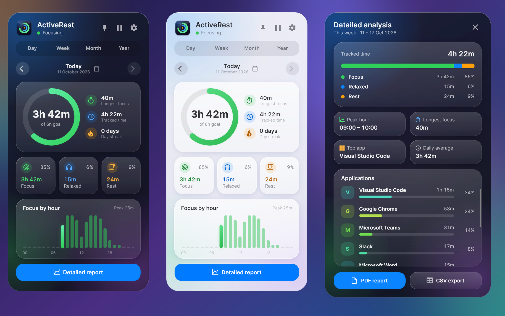
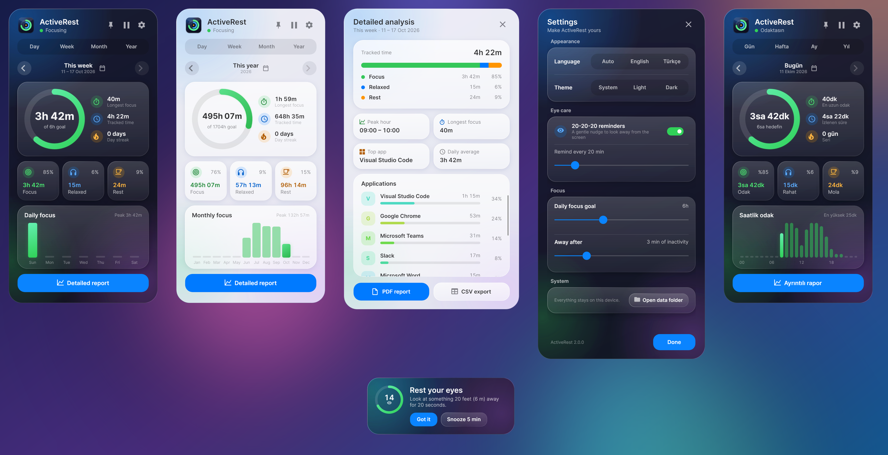

# ActiveRest

[](https://github.com/furkiak/ActiveRest/actions/workflows/ci.yml)
[](https://github.com/furkiak/ActiveRest/releases/latest)


<p align="center">
  
</p>

**ActiveRest** is a quiet focus tracker and eye-care companion that lives in your system tray. It watches how you actually work — keyboard and mouse activity, the foreground application and audio playback — and turns that into a clear picture of your day: how long you focused, when you were most productive, where the time went, and whether you hit your goal. A gentle 20-20-20 reminder looks after your eyes while you do it.

Everything stays on your computer. There is no account, no cloud and no network access.

*Türkçe açıklama için [aşağıya](#-türkçe) bakın.*

---

## Features

**Understand your day**
- **Goal ring** – a live activity ring shows today's focus time against your daily goal, with your current **day streak** next to it.
- **Day, Week, Month and Year views** with previous/next navigation, a calendar picker and a "back to today" shortcut.
- **Trend chart** – focus by hour for a day, daily focus for a week or month, monthly focus for a year. Days that reached the goal are highlighted.
- **Highlights** – peak hour, longest uninterrupted focus, top application and daily average.
- **Per-application breakdown** with friendly names, colour-coded bars and percentages.
- **Live status** – see at a glance whether you are focusing, relaxing or on a break.

**Look after yourself**
- **20-20-20 reminders** – a soft toast with a 20-second countdown ring, *Snooze* and *Got it* buttons. It never steals keyboard focus from the window you are typing in, and a real break (a minute away from the keyboard) resets the timer.
- **Pause tracking** from the window or the tray menu.

**Share and keep**
- **PDF reports** – paginated, print-friendly reports with totals, a day-by-day (or month-by-month) breakdown and application shares.
- **CSV export** – spreadsheet-ready (UTF-8, whole seconds, formula-injection safe).

**Polish**
- **Liquid Glass design** – translucent glass surfaces with specular rims, soft shadows and a colourful backdrop, in **light and dark** mode that follows the system or your choice.
- **English and Turkish**, switchable at runtime.
- **Tray-first**: starts quietly with Windows, hides when you click away and can be pinned open.
- **Keyboard**: `Esc` hides the window, `←` / `→` move between periods.
- **Single instance** – launching it again simply brings the running app forward.

<p align="center">
  
</p>

## How activity is classified

Once per second ActiveRest classifies your time into one of three modes:

| Mode | When | Counted |
|------|------|---------|
| **Focus** | Keyboard or mouse input within the idle threshold (default 3 min) | Time per application and per hour |
| **Relaxed** | Away from the keyboard **while audio is playing** (video, music, a call) | Media time |
| **Rest** | Away from the keyboard and silent | Break time |

Short notification sounds do not flip Rest into Relaxed (audio must persist for a few seconds), and time during which the computer was asleep is never attributed to any mode.

## Download

Grab the latest build from the [Releases page](https://github.com/furkiak/ActiveRest/releases/latest) — a single executable, no installer:

| File | For |
|------|-----|
| `ActiveRest-<version>-win-x64.exe` | Any Windows 10 / 11 PC — nothing else to install |
| `ActiveRest-<version>-win-x64-framework-dependent.exe` | A much smaller download if the [.NET 9 Desktop Runtime](https://dotnet.microsoft.com/download/dotnet/9.0) is installed |

The app is not code-signed, so SmartScreen may warn on the first launch: choose **More info → Run anyway**. `SHA256SUMS.txt` lists the checksums.

## Building from source

**Requirements:** Windows 10 or 11 and the .NET 9 SDK.

```bash
git clone https://github.com/furkiak/ActiveRest.git
cd ActiveRest

dotnet run                                   # run from source
dotnet test tests/ActiveRest.Tests           # unit tests

# a single-file release build for Windows
dotnet publish ActiveRest.csproj -c Release -r win-x64 --self-contained false \
  -p:PublishSingleFile=true -p:IncludeNativeLibrariesForSelfExtract=true \
  -p:IncludeAllContentForSelfExtract=true -o publish
```

The CI workflow builds and tests every push and publishes the Windows executable as a build artifact. Pushing a version tag (`v2.0.0`) runs the release workflow, which tests, builds both executables and publishes a GitHub release with the matching CHANGELOG section.

The interface also starts on Linux and macOS (useful for development), but there the activity tracker is a stub that always reports "active" — real tracking uses Win32 APIs.

### Settings

Everything applies instantly: language, theme, 20-20-20 reminders and interval (5–120 min), daily focus goal (0.5–16 h), the inactivity threshold (1–10 min) and *Start with Windows*.

### Where your data lives

`%APPDATA%\ActiveRest\`

| File | Purpose |
|------|---------|
| `stats.json` | Daily statistics (written atomically once a minute and on exit) |
| `stats.json.bak` | The previous good copy, used automatically if `stats.json` is damaged |
| `settings.json` | Your preferences |
| `activerest.log` | Diagnostics (trimmed at 256 KB) |

Set the `ACTIVEREST_DATA_DIR` environment variable to use a different folder.

## Architecture

```
ActiveRest
├─ Models/          DailyStat, AppSettings, PeriodSummary, ReportData …
├─ Services/
│  ├─ TrackerEngine        classifies each second; single-threaded, clock- and tracker-injectable
│  ├─ DataManager          cached, atomic JSON store with backup and corrupt-file recovery
│  ├─ SettingsStore        one shared settings object that notifies its subscribers
│  ├─ StatsAggregator      pure functions: ranges, summaries, chart data, streaks
│  ├─ WindowsActivityTracker / NullActivityTracker   platform abstraction (IActivityTracker)
│  ├─ PdfExportService, CsvExportService, ReportBuilder
│  └─ StartupService, SingleInstanceGuard, Logger, AppServices (composition root)
├─ Localization/    Loc + {loc:T Key} markup extension (EN/TR, live switching)
├─ ViewModels/      Main, Details, Settings, Toast  (CommunityToolkit.Mvvm)
├─ Views/           MainWindow, DetailsWindow, SettingsWindow, ToastWindow
├─ Styles/          Theme (light/dark glass tokens), Icons, Controls
├─ tests/           xUnit: aggregation, storage, engine, export, localization
└─ tools/           icon generator, headless screenshot / UI smoke-test tool
```

Design decisions worth knowing:

- **The tracking engine owns no timer and no UI.** The host calls `Tick()` once a second on the UI thread, so there are no locks and no races, and the whole engine is unit-tested with a fake clock and a fake tracker. Elapsed time is measured with the wall clock, so lag, sleep and hibernation cannot skew the totals.
- **The hidden window costs (almost) nothing.** While the window is hidden only the engine ticks; summaries, charts and lists are recomputed only when the window is visible.
- **Storage is crash-safe.** The history is cached in memory, written through a temporary file and a rolling backup, and an unreadable file is quarantined instead of overwritten.
- **Glass without a blur API.** Avalonia has no backdrop blur for shaped, frameless windows, so the glass is built from layered gradients, specular rim lights and soft shadows over per-pixel transparency. Static gradients keep repaints cheap.

### Screenshots and smoke tests

The images in this README are rendered from the real windows with seeded demo data, using Avalonia's headless Skia platform (no display needed):

```bash
dotnet run --project tools/Screenshots -- shots --scale 2 --matte     # raw renders
python3 tools/make_readme_images.py shots docs/screenshots            # README composites
dotnet run --project tools/Screenshots -- shots --selftest            # UI smoke test (also run by CI)
python3 tools/make_icon.py                                            # regenerate the app icon
```

> Avalonia's build tooling sends anonymous build telemetry. Set `AVALONIA_TELEMETRY_OPTOUT=1` if you prefer to opt out.

### Built with

.NET 9 · [Avalonia UI](https://avaloniaui.net/) 11 · [CommunityToolkit.Mvvm](https://learn.microsoft.com/dotnet/communitytoolkit/mvvm/) · [NAudio](https://github.com/naudio/NAudio) (Core Audio) · [QuestPDF](https://www.questpdf.com/) · Newtonsoft.Json · Inter typeface

See [CHANGELOG.md](CHANGELOG.md) for what changed in 2.0.

## License

[MIT](LICENSE)

---

## 🇹🇷 Türkçe

**ActiveRest**, sistem tepsisinde sessizce çalışan bir odak takipçisi ve göz sağlığı yardımcısıdır. Gerçekte nasıl çalıştığınızı — klavye ve fare etkinliği, öndeki uygulama ve ses çalma durumu — izler ve gününüzü net bir tabloya dönüştürür: ne kadar odaklandınız, en verimli saatiniz hangisiydi, zaman nereye gitti ve hedefinize ulaştınız mı. Siz çalışırken nazik bir 20-20-20 hatırlatıcısı gözlerinizi korur.

Tüm veriler bilgisayarınızda kalır. Hesap, bulut ya da ağ erişimi yoktur.

### Özellikler

**Gününüzü anlayın**
- **Hedef halkası** – günlük odak hedefinize göre canlı ilerleme halkası ve yanında **gün serisi**.
- **Gün, Hafta, Ay ve Yıl görünümleri**; önceki/sonraki gezinme, takvimden tarih seçme ve "bugüne dön" kısayolu.
- **Trend grafiği** – gün için saatlik, hafta/ay için günlük, yıl için aylık odak. Hedefe ulaşılan günler vurgulanır.
- **Öne çıkanlar** – en verimli saat, en uzun kesintisiz odak, en çok kullanılan uygulama ve günlük ortalama.
- **Uygulama dökümü** – anlaşılır isimler, renkli çubuklar ve yüzdeler.
- **Canlı durum** – odakta mısınız, rahat modda mı yoksa molada mı, tek bakışta görün.

**Kendinize iyi bakın**
- **20-20-20 hatırlatıcısı** – 20 saniyelik geri sayım halkalı, *Ertele* ve *Tamam* düğmeli nazik bir bildirim. Yazı yazdığınız pencereden klavye odağını asla çalmaz; bir dakikalık gerçek mola sayacı sıfırlar.
- **Takibi duraklatma** – pencereden veya tepsi menüsünden.

**Paylaşın ve saklayın**
- **PDF raporu** – toplamlar, gün gün (yıl için ay ay) döküm ve uygulama payları içeren, yazdırmaya uygun çok sayfalı rapor.
- **CSV dışa aktarma** – elektronik tabloya hazır (UTF-8, tam saniye, formül enjeksiyonuna karşı güvenli).

**Cila**
- **Liquid Glass tasarım** – ışıltılı kenarlar, yumuşak gölgeler ve renkli arka planla yarı saydam cam yüzeyler; sistemi izleyen veya elle seçilen **açık ve koyu tema**.
- **Türkçe ve İngilizce**, çalışırken değiştirilebilir.
- **Tepsi odaklı**: Windows ile sessizce başlar, başka yere tıklayınca gizlenir, sabitlenebilir.
- **Klavye**: `Esc` pencereyi gizler, `←` / `→` dönemler arasında gezinir.
- **Tek örnek** – tekrar başlatmak çalışan uygulamayı öne getirir.

### Etkinlik nasıl sınıflandırılır

ActiveRest her saniyeyi üç moddan birine yazar:

| Mod | Ne zaman | Neye sayılır |
|-----|----------|--------------|
| **Odak** | Boşta kalma eşiği (varsayılan 3 dk) içinde klavye/fare girişi | Uygulama ve saat bazlı süre |
| **Rahat** | Klavyeden uzakta **ve ses çalıyor** (video, müzik, görüşme) | Medya süresi |
| **Mola** | Klavyeden uzakta ve sessiz | Mola süresi |

Kısa bildirim sesleri Mola'yı Rahat'a çevirmez (ses birkaç saniye sürmelidir); bilgisayarın uyku modunda geçirdiği süre hiçbir moda yazılmaz.

### İndirme

Son sürümü [Releases sayfasından](https://github.com/furkiak/ActiveRest/releases/latest) indirin — tek bir exe, kurulum yok:

| Dosya | Kimin için |
|-------|-----------|
| `ActiveRest-<sürüm>-win-x64.exe` | Her Windows 10 / 11 bilgisayar — başka bir şey kurmanız gerekmez |
| `ActiveRest-<sürüm>-win-x64-framework-dependent.exe` | [.NET 9 Desktop Runtime](https://dotnet.microsoft.com/download/dotnet/9.0) kuruluysa çok daha küçük indirme |

Uygulama kod imzalı olmadığından SmartScreen ilk açılışta uyarabilir: **Ek bilgi → Yine de çalıştır** deyin. Sağlama toplamları `SHA256SUMS.txt` dosyasındadır.

### Kaynaktan derleme

**Gereksinimler:** Windows 10 veya 11 ve .NET 9 SDK.

```bash
git clone https://github.com/furkiak/ActiveRest.git
cd ActiveRest

dotnet run                                   # kaynaktan çalıştır
dotnet test tests/ActiveRest.Tests           # birim testleri

# Windows için tek dosyalık sürüm
dotnet publish ActiveRest.csproj -c Release -r win-x64 --self-contained false \
  -p:PublishSingleFile=true -p:IncludeNativeLibrariesForSelfExtract=true \
  -p:IncludeAllContentForSelfExtract=true -o publish
```

Bir sürüm etiketi (`v2.0.0`) push edildiğinde release workflow'u testleri çalıştırır, iki exe'yi derler ve CHANGELOG'daki ilgili bölümle bir GitHub sürümü yayımlar.

Arayüz Linux ve macOS'ta da açılır (geliştirme için), ancak orada etkinlik takipçisi her zaman "aktif" döndüren bir taslaktır; gerçek takip Win32 API'lerini kullanır.

**Ayarlar** anında uygulanır: dil, tema, 20-20-20 hatırlatıcısı ve aralığı (5–120 dk), günlük odak hedefi (0,5–16 sa), hareketsizlik eşiği (1–10 dk) ve *Windows ile başlat*.

**Verileriniz** `%APPDATA%\ActiveRest\` klasöründedir: `stats.json` (istatistikler; dakikada bir ve çıkışta atomik yazılır), `stats.json.bak` (dosya bozulursa otomatik kullanılan önceki sağlam kopya), `settings.json` ve `activerest.log`. Farklı bir klasör için `ACTIVEREST_DATA_DIR` ortam değişkenini kullanın.

### Mimari

Takip motoru ne zamanlayıcı ne de arayüz içerir; ana bilgisayar saniyede bir `Tick()` çağırır. Böylece kilit ve yarış durumu yoktur, motor sahte saat ve sahte takipçiyle birim testlerine tabidir ve uyku/gecikme toplamları bozamaz. Pencere gizliyken yalnızca motor çalışır. Veri deposu bellekte önbelleklenir, geçici dosya ve yedek üzerinden yazılır; okunamayan dosya ezilmez, karantinaya alınır. Cam görünümü, Avalonia'da çerçevesiz pencereler için arka plan bulanıklaştırması olmadığından, katmanlı gradyanlar, ışıltılı kenarlar ve yumuşak gölgelerle üretilir.

Ayrıntılar için yukarıdaki *Architecture* bölümüne ve [CHANGELOG.md](CHANGELOG.md) dosyasına bakın.

### Lisans

[MIT](LICENSE)

<p align="center">
  <i>ActiveRest — Work smarter, stay healthy. · Akıllı çalış, sağlıklı kal.</i>
</p>
