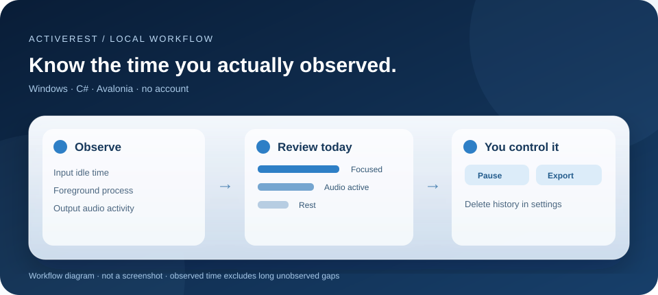
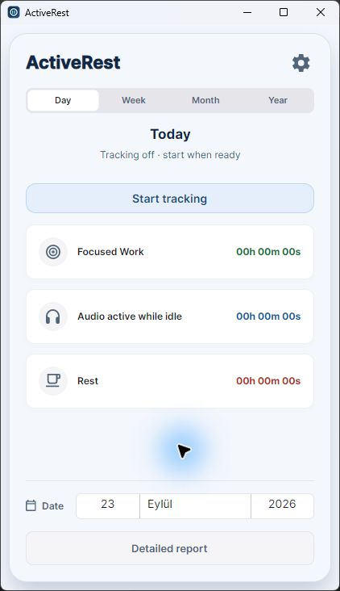

# ActiveRest

**A local activity timer for Windows.** ActiveRest shows how much observed time your device spent active, idle with audio output, or idle without it. It displays foreground process totals, offers a configurable break reminder, and exports a PDF or JSON report. Built with C# 13, .NET 9 and Avalonia 11.





The [detailed report preview](docs/windows-report-preview.jpg) shows the empty state before tracking starts. Both images were captured from a Windows 11 desktop session on 23 September 2026; the workflow diagram is conceptual. The main window, settings, and empty report opened in that session. Tracking, tray, registry, export and clean-machine installation still need separate interactive checks.

## Try it

Requires Windows with the .NET 9 SDK for source builds. From the repository root:

```powershell
dotnet run --project ActiveRest.csproj
```

The app opens with tracking **off**. Select **Start tracking** in the main window to begin, then use **Pause tracking** or **Resume tracking** as needed. Each launch starts with tracking off, including launches triggered by the optional Windows auto-start setting. **Settings** offers the reminder interval, Monday/Sunday week start, Windows auto-start, **Export JSON**, **Open folder**, and **Delete history**. Deleting history also stops tracking until you start it again. The tray menu can reopen or exit the app. `dotnet test ActiveRest.Tests/ActiveRest.Tests.csproj -c Release` runs the behavior tests.

There is no current public installer for this revision. A source build is the reproducible path until the Windows release package passes a clean-machine UI check. Do not interpret an older ZIP or image as this revision.

## How the numbers are calculated

| Display | Current rule |
| --- | --- |
| Focused work | Input idle time is under 180 seconds. The foreground **process name** receives the observed duration. |
| Comfortable working | Input has been idle for at least 180 seconds while the default output device's audio peak is above a threshold. This is an audio activity heuristic, not proof that media is playing. |
| Rest | Input has been idle for at least 180 seconds and the audio heuristic is false. |

Elapsed time between ordinary samples is measured rather than assuming every timer callback represents exactly one second. Unobserved gaps longer than five seconds, including sleep and long stalls, are **excluded**, so totals can be lower than wall-clock time. A sample crossing local midnight is split between days; the previous day is saved first. The weekly view uses Monday by default, with a Sunday preference. A reminder is based on consecutive observed focus time and does not diagnose or prevent eye strain.

## Privacy and data control

ActiveRest runs locally and has no account, analytics service, or upload path in this source. It reads the foreground process name, Windows input idle duration and output-device audio peak. It does **not** read window titles, keystrokes, screenshots, microphone input, or audio content. Process names can still reveal personal behavior; treat exported files as private.

After you start tracking, daily duration totals and process names are kept in `%APPDATA%\ActiveRest\stats.json`; the previous valid write is in `stats.json.bak`. Reminder and week settings are in `settings.json`. Data remains until you delete it. The app saves about once per observed minute and on pause, day change, and exit while tracking. Merely opening and closing the app does not create a new history record. Settings → **Export JSON** copies the recorded history to a file you choose. Settings → **Delete history** stops tracking and removes the main history and backup after an in-app confirmation. Exported copies and older `.corrupt-*` recovery files are separate files; delete those from **Open folder** if you no longer need them. Normal filesystem deletion is not secure erasure on SSDs.

If the main history file is malformed, ActiveRest tries the last valid backup and preserves the damaged copy with a `.corrupt-*` suffix. If neither copy is readable, tracking pauses and the app leaves both files untouched for manual recovery. See [data recovery](docs/DATA.md).

## PDF reports and limits

The **Detailed Report** view exports a PDF to a location you choose. The report summarizes the selected date range and process totals; it is not a health, performance or productivity score. The app uses Windows-specific activity and startup APIs and an approximate audio rule. The foreground process total covers active samples only; it does not prove which document or browser tab was used. PDF export, the date picker and error display still need native Windows UI checks before public release.

## Development

```powershell
dotnet restore ActiveRest.Tests/ActiveRest.Tests.csproj
dotnet test ActiveRest.Tests/ActiveRest.Tests.csproj -c Release
dotnet publish ActiveRest.csproj -c Release -r win-x64 --self-contained true -p:PublishSingleFile=false
```

The source tree includes [tests](ActiveRest.Tests/TrackingTests.cs) for midnight, sleep gaps, pause/resume, opt-in startup, changed reminder settings, week boundaries, backup recovery and deletion. The main, settings and empty-report screens were visually inspected on Windows; registry startup, tray, PDF and clean-profile checks remain release gates. See [support and release checks](docs/SUPPORT.md), [contributing](CONTRIBUTING.md), and [changelog](CHANGELOG.md). Licensed under [MIT](LICENSE).

## Türkçe

ActiveRest, Windows üzerinde çalışan **yerel bir etkinlik zamanlayıcısıdır**. Gözlenen etkin süreyi, ses çıkışı varken boşta geçen süreyi ve mola süresini gösterir. Ön plandaki **işlem adını** kaydeder; pencere başlığı, tuş vuruşu, ekran görüntüsü, mikrofon veya ses içeriği toplamaz. Varsayılan veri konumu `%APPDATA%\ActiveRest` klasörüdür. Uygulama her açılışta takip kapalı başlar; ana ekrandaki **Start tracking** düğmesine basınca ölçüm başlar. Takibi duraklatabilir, Ayarlar’dan JSON dışa aktarabilir veya geçmişi onaylayarak silebilirsin. Geçmişi silmek takibi de durdurur. Bu sürüm sağlık ya da verimlilik sonucu vaat etmez. Ana ekran, ayarlar ve boş rapor gerçek Windows oturumunda kontrol edildi; takip, tepsi, PDF ve temiz kullanıcı profili testleri yayın öncesi açıktır.
