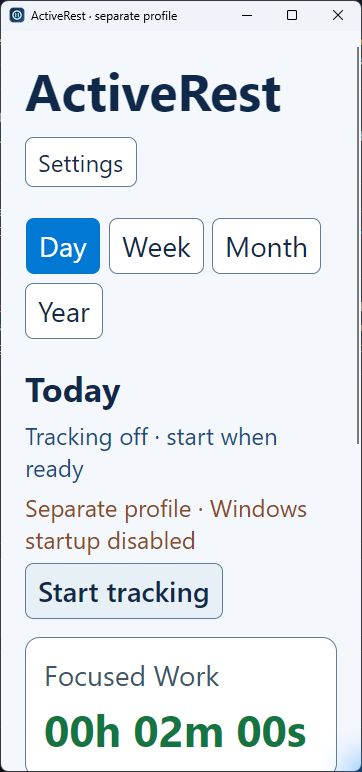
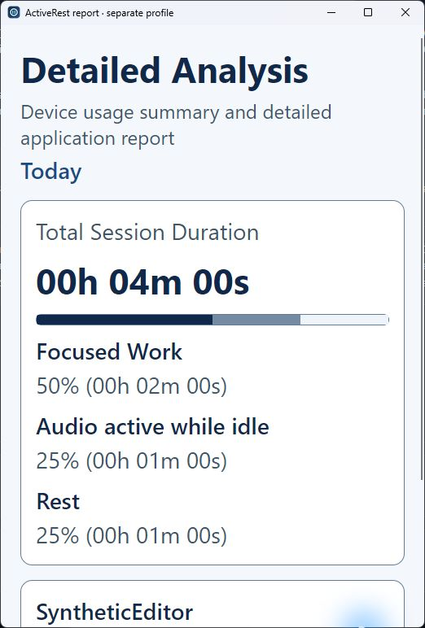

# Appearance preferences and native acceptance

Settings → **Appearance** offers Light/Dark and 100%/150%/200% text size. **Save Changes** commits preferences to the selected profile, updates dynamic resources across windows, then closes Settings. Changes are not previewed before Save, so closing without saving leaves the appearance unchanged. Each launch reads that profile's saved preferences. Legacy files use Light/100%; invalid values/main/backup files stay preserved and show recovery guidance.

Font resources are multiplied by 1, 1.5 or 2. This is real FontSize scaling, not a DPI change or RenderTransform. Main, Settings and Details use vertical scrolling, auto content heights and wrapping actions. The three-part DatePicker has horizontal scrolling when needed; its supported Fluent width/item-height resources are also scaled to keep larger text readable. Its popup retains the existing date-selection behavior. No data category or clock rule changes with appearance. The PDF remains a separate, fixed report layout.

Opaque Window/Card/Soft/Hover surfaces define the hierarchy. No Acrylic/Mica/background blur is used, and no blur interaction cost has been measured. Application-owned transitions and pressed scaling are removed; this is not a claim to change OS-wide animation preferences. Light/Dark are explicit app choices rather than automatic high-contrast mode handling.

## Source palette measurements

sRGB relative luminance, (lighter + .05)/(darker + .05). Values below are the minimum across the Window/Card/Soft/Hover surfaces, except category text which appears on CardSurface. Application brushes are fully opaque, so there is no unknown desktop background in these calculations.

| Token/check | Light | Dark |
| --- | ---: | ---: |
| Primary text | 11.01:1 | 8.31:1 |
| Secondary text | 5.81:1 | 5.68:1 |
| Accent text | 6.51:1 | 5.67:1 |
| Warning text | 5.16:1 | 5.81:1 |
| Control boundary | 3.26:1 | 3.50:1 |
| Keyboard focus outline | 6.51:1 | 6.73:1 |
| Focus/audio/rest text, minimum on card | 5.75:1 | 8.03:1 |
| Adjacent measured-time bar segments, minimum | 3.17:1 | 3.26:1 |

These are application-token calculations, not an audit of rendered native popup/disabled/host states. The 2px keyboard FocusAdorner uses the focus token; pointer focus does not substitute for a keyboard focus check. Normal widget keyboard behavior is retained.

## Evidence and pending native checks

The 38 behavior tests include the earlier 26 tracking/profile checks, legacy settings upgrade, settings/backup preservation, restart persistence, invalid appearance save refusal and reminder reload while tracking remains active. They do not instantiate a native window or prove a layout screenshot. No tests merely assert XAML strings/style structure.

Use the new package and a disposable **absolute** `--data-directory`, never the normal data folder. Record commit/package hash, Windows version and display scaling. Do not change OS display settings for this test.

1. Start with tracking off. Open Settings; ensure startup is disabled and the supplied folder is visible. Select Dark/200%, Save; reopen Settings and confirm both choices. Close/restart with the same profile and confirm persistence. Repeat Light/150% and Light/100%.
2. In both themes, test 200% at the default window size and after narrowing to the allowed minimum. Scroll Main, Settings and Details to reach every control. Period actions/data actions must wrap; labels, durations and reminder interval must stay readable. The date field may scroll horizontally; its popup must show full day/month/year values and accept/cancel correctly.
3. Use Tab/Shift+Tab and keyboard activation to reach Settings, each period, Start/Pause, the date field, Details, appearance selectors, interval controls and Save. Focus must remain visible with the strong outline and scroll into view; no keyboard trap. Open the theme/font lists with keyboard and inspect their popup text/selected states.
4. While tracking in the disposable profile, change appearance only. Totals should continue without reset; Pause should still freeze totals. Check a selected week before/after and export the report. Font preference does not enlarge the PDF.
5. Cancel the history-deletion dialog at 200%; all prompt/buttons must be readable and reachable. Verify native reminder sizing when due. Finish with normal history/settings/Run-entry hashes unchanged. Record any popup clipping, unexpected widget animation or low-contrast state rather than treating source palette results as complete native acceptance.

## Native Windows check, 27 September 2026

The revised application was exercised on Windows 11 with a disposable absolute profile and synthetic initial totals. Light/100% legacy defaults opened correctly. Dark/200% saved, survived process exit/restart and remained selected on reopening Settings. Light/200% and Dark/150% were then saved through the native controls. These are real font changes; Windows display scaling was not changed.

At the 360px main/settings minimum width, actions wrap and keyboard navigation scrolls the focused control into view. A title clipping problem found at 200% was corrected by wrapping the title and Settings action. Main, Settings and the detailed report were inspected at 200%; theme/font dropdown values, reminder text, duration cards and report controls remained readable. The native Fluent keyboard outline was visibly strong in both themes; this does not prove the custom focus token is used by every template.

The date popup showed full day/month/year values at 200%. At 150% its explicit **Choose report date**, **Apply date** and **Cancel date** names appeared in Windows UI Automation. Cancelling from a maximized owner left the report date unchanged. The automation helper could not click a popup point outside a narrow owner window's capture bounds; the maximized-owner check is not evidence that every small-screen popup interaction passed.

Changing appearance while tracking left tracking active and did not reset totals. Pause then froze totals across subsequent observations. A real PDF was saved from the Light/200% report and rendered for visual inspection: one readable page with the same fixed report layout and synthetic initial totals. Normal profile files and the Windows Run-entry digests matched the before/after snapshots exactly; the separate-profile startup control remained disabled.

Native reminder delivery, history-deletion confirmation, normal startup/tray, physical sleep/midnight, screen-reader output, alternate Windows DPI, other display sizes and clean-machine installation are still pending. These observations and source palette ratios are not a WCAG conformance claim. Historical tracking/date/weekly JSON checks remain separate evidence for the earlier layout.

## Türkçe

Açık/koyu tema ile %100/%150/%200 yazı tercihi yalnız seçilen profilin ayarına kaydedilir. Kaydetmeden pencereyi kapatmak görünümü değiştirmez. Fontlar büyür; DPI/Windows ekran ölçeği veya kişisel başlangıç ayarı değiştirilmez. Yüzeyler opaktır, blur yoktur. 38 davranış testine ek olarak ayrı profilde gerçek Windows tema/font kaydı, yeniden açılış, dar pencere, klavye odağı/kaydırma, takip sırasında görünüm değişimi, duraklatma ve PDF dışa aktarma kontrol edildi. Normal profil ve başlangıç kaydının hash değerleri değişmedi. Hatırlatıcı, silme onayı, tepsi, farklı DPI, ekran okuyucu ve temiz makine kontrolleri hâlâ açıktır; kaynak renk hesapları tam erişilebilirlik sertifikası değildir.

The DatePicker sizing overrides follow the pinned [Avalonia 11.2.7 Fluent DatePicker source](https://github.com/AvaloniaUI/Avalonia/blob/11.2.7/src/Avalonia.Themes.Fluent/Controls/DatePicker.xaml); recheck these resource keys when upgrading Avalonia.
