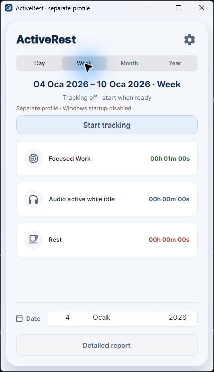
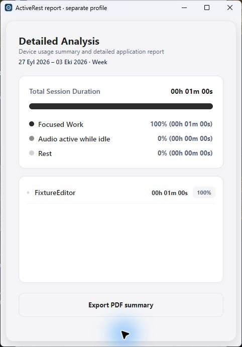
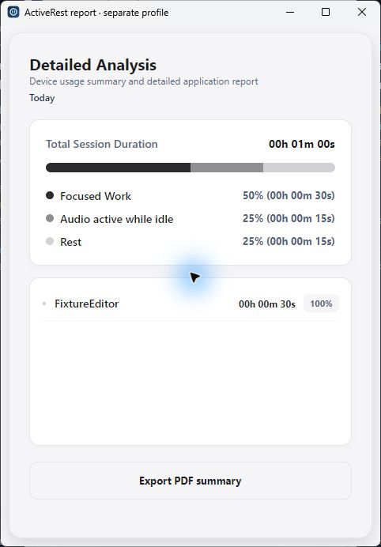

# Native Windows validation

27 September 2026, Windows 11, self-contained Windows x64 development build. All tracking and fixture history used absolute separate data directories. This does not certify a fresh-machine install or a production release.

| Interaction | Observed result |
| --- | --- |
| Initial launch | Tracking off, separate-profile title and startup-disabled notice |
| Start / Pause / Resume | Real foreground ActiveRest process accumulated time; paused total stayed stable; Resume added observed time |
| Reminder settings | Changed 20 to 25 minutes, saved, reopened: 25 persisted in the test folder |
| Startup | Checkbox disabled in separate profile; normal Run-entry digest remained unchanged during settings/export checks |
| Export JSON | Native save picker wrote the chosen test folder; parsed export equalled saved history |
| Date selection | Native picker selected 4 January 2026, showing the synthetic 20-second day |
| Weekly totals | Monday start: 30 seconds; Sunday start: 60 seconds; changed without restart |
| Period label | Selected week range remains visible after mode change, in the detailed report and PDF |
| Native PDF | Chosen test-folder PDF contained the selected 4–10 January week, FixtureEditor and 60 seconds; one page independently rendered and inspected |
| Incompatible history/settings | Start refused; Settings Save displayed recovery error; original JSON bytes remained unchanged |
| Activity bar | The former three equal segments for a 100% focus fixture were reproduced and fixed; native report now fills the bar correctly; a 30/15/15-second fixture also shows 50%/25%/25% |

The January fixture contains 29 December 2025 (10 seconds), 4 January 2026 (20), 5 January (40) and 11 January (80). Automated view-model checks exercise both tr-TR and en-US. Additional native chart checks use clearly synthetic current-date records; they are not productivity measurements.

26 automated tests cover the timer, rollover, long unobserved gaps, snapshot isolation, week boundaries, damaged/newer history preservation, confirmed engine deletion and PDF rendering. A direct engine test is distinct from a native picker or confirmation check. No normal user history was used. Registry digest checks do not disclose the registry value.

Full keyboard/screen-reader/scaling coverage, actual OS sleep/midnight, normal startup, tray Safe Exit, native destructive confirmation and fresh-machine installation need separate evidence. The separate-profile argument is storage separation, not a Windows security sandbox.
